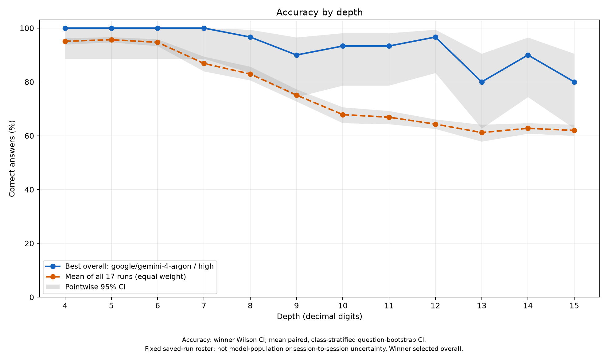
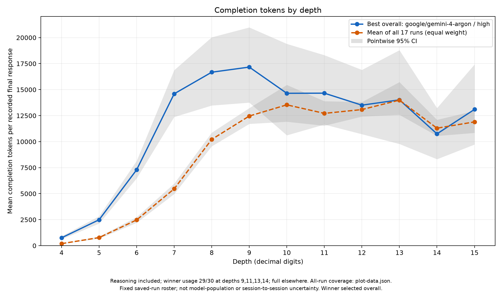

# is-prime-eval

**One integer. Two labels. How far can an LLM reason without tools?**

Ask a model whether a number is prime, then turn up the digits. This small, prompt-only benchmark uses balanced prime/composite questions with exact labels, frozen inputs, and auditable API ledgers. No calculators, code execution, or tools are supplied to the model.

## Leaderboard · 7–15 digits

The hard slice: **270 questions per model/reasoning setting**, 15 primes + 15 composites at each depth. Sorted by accuracy; invalid answers and exhausted requests count as incorrect. The reasoning setting follows the model name after `-`; no suffix means provider-default reasoning, not necessarily no reasoning.

<!-- leaderboard:start -->

| Model | Accuracy | Tokens | Cost | API time |
|---|---:|---:|---:|---:|
| gemini-4-argon-high | 91.1% | 3,831,472 | $38.200 | 12h14m |
| deepseek-v4.1-flash-1017-low | 90.4% | 9,319,178 | $4.676 | 11h34m |
| deepseek-v4.1-flash-1017-medium | 89.6% | 8,720,152 | $4.538 | 11h03m |
| deepseek-v4.1-flash-1017-high | 86.7% | 11,881,493 | $5.812 | 14h39m |
| gpt-6.1-sol-medium | 83.7% | 1,321,029 | $13.160 | 8h58m |
| claude-opus-5.5-high | 82.2% | 1,724,765 | $34.335 | 4h29m |
| gpt-6.1-sol-low | 71.1% | 357,012 | $3.520 | 2h37m |
| claude-haiku-5.5-xhigh | 65.6% | 3,833,346 | $1.913 | 4h18m |
| gpt-6-luna-xhigh | 64.8% | 1,793,365 | $0.894 | 5h33m |
| gpt-6-luna-low | 63.7% | 184,683 | $0.090 | 57m30s |
| claude-haiku-5.5-high | 61.1% | 431,790 | $0.212 | 44m51s |
| claude-haiku-5.5-medium | 60.7% | 250,397 | $0.121 | 32m54s |
| claude-haiku-5.5-low | 59.3% | 172,132 | $0.082 | 27m12s |
| mercury-3 | 58.1% | 8,149,270 | $2.851 | 3h03m |
| gpt-6-luna-high | 57.0% | 992,386 | $0.494 | 3h25m |
| gpt-6-luna-medium | 54.4% | 507,826 | $0.251 | 1h52m |
| gpt-4-turbo | 50.0% | 7,023 | $0.081 | 7m55s |

<!-- leaderboard:end -->

Tokens (prompt + completion), provider-reported cost in USD, and API request time cover the same 7–15-digit slice, including retries. API time is summed request latency, **not** wall-clock runtime. Tokens and cost are recorded subtotals where transport failures left usage unknown; missing charges are not assumed to be zero. See the [compact leaderboard](leaderboard.md) for exact units and coverage, or the [in-depth analysis](analysis.md) for full-depth scores, class breakdowns, routes, uncertainty, and cost estimates. Models did not all receive identical frozen questions, so small rank differences are not evidence of superiority.

## Where does reasoning break down?

The plots retain the full **4–15-digit** range to show the transition from easy to hard. Blue is the single best overall full-range run; orange is the equal-weight mean of all 17 completed model/reasoning runs—not an average over distinct model families. Gray bands are pointwise 95% intervals, conditional on the saved runs and winner selection.

<a href="graphs/accuracy-vs-depth.png"></a>

<a href="graphs/tokens-vs-depth.png"></a>

Click either plot to view it full size.

The token plot measures **mean final-response completion tokens**, including reported reasoning. It excludes failed attempts and missing usage, unlike leaderboard totals. [Plot methodology, coverage, and reproducibility →](graphs/README.md)

## The eval in 30 seconds

> Is {number} prime? Reply with only PRIME or COMPOSITE.

- **360 questions per full run:** depths 4–15, balanced at 15 prime + 15 composite per depth. The leaderboard drops easy depths 4–6; the analysis retains them.
- **Exact labels:** deterministic Miller–Rabin within the supported ≤15-digit range. Questions and seeds are saved and hashed; no model tools are provided.
- **Strict scoring:** only `PRIME` or `COMPOSITE` labels are accepted (case/whitespace and one final `.`, `!`, or `?` are tolerated). Explanations, refusals, truncation, and exhausted requests reduce accuracy. Invalid outputs are not retried to improve a score.
- **Visible budget:** published runs have no evaluator-imposed completion cap, but provider output limits still apply. Reasoning controls and routes are provider-dependent. This measures performance under this specific prompt and API policy, not unrestricted mathematical ability.
- **Auditable data:** 17 complete runs, including 14 composed parent+extension runs. [Raw results and frozen question sets](results/README.md) are retained for verification and resume—not caches.

## Run it

Python **3.11+**; the evaluator and reports use the standard library. Matplotlib is optional for regenerating charts. Live inference uses OpenRouter and incurs charges.

```sh
python3 -m venv .venv
cp .env.sample .env
# Set OR_KEY in .env, then inspect settings before spending:
.venv/bin/python run.py --model-id inception/mercury-3 --dry-run
# Remove --dry-run to evaluate.
```

A dry run contacts the model catalog but sends no completion requests. Defaults: 600-second socket inactivity timeout, provider-default reasoning, no completion-token cap, five retries, and a shared 15-request/minute gate.

### Reproduce the published views offline

No key, paid requests, or network access is needed after installing the optional plotting dependency:

```sh
.venv/bin/python -m pip install -r requirements-plots.txt
.venv/bin/python scripts/report.py --results-dir results --output leaderboard.md --readme README.md
.venv/bin/python scripts/report.py --results-dir results --format analysis --output analysis.md
.venv/bin/python scripts/plot_results.py
.venv/bin/python -m unittest discover -s tests -v
```

[Full usage, request policy, parallel runs, resume, and depth extension →](docs/usage.md)
